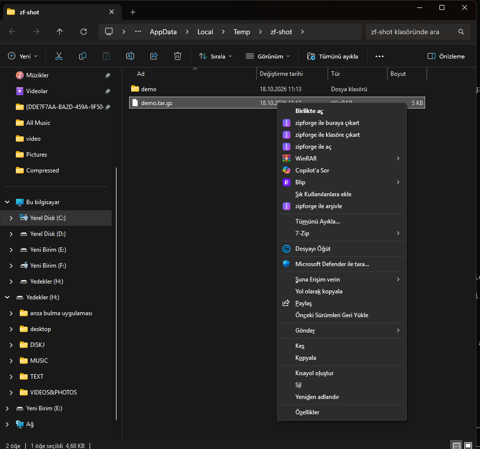

<div align="center">
  
</div>

<h1 align="center">zipforge</h1>

<p align="center">
  A fast, modern, open-source archive manager for Windows, Linux and macOS.<br/>
  Built with <b>Tauri v2</b> + <b>Rust</b> + <b>React</b> — small, native and quick.
</p>

<p align="center">
  
  
  
  
</p>

---

## Why zipforge?

- **Fast** — powered by the battle-tested 7-Zip engine (native C/C++), wrapped in a small Rust core.
- **Lightweight** — a Tauri app: uses the system WebView2 instead of bundling a browser (~10 MB installer vs ~150 MB for Electron apps).
- **Modern UI** — clean dark/light interface, drag & drop, keyboard-friendly, Turkish + English, no ads, no nag screens.
- **Honest formats** — opens everything you throw at it, creates the formats everyone actually uses.

## Features

- Open & browse archives without extracting, with instant search and sorting
- **Large archives stay responsive** — the entry list is virtualized, so a 50 000-file archive renders ~25 rows instead of blocking the window
- Extract all or only the selected entries, with real-time progress and cancel
- Create **zip / 7z / tar / tar.gz** archives with compression level selection
- **AES-256** password protection (zip & 7z), encrypted-header option for 7z
- **Split volumes** (e.g. 100 MB, 650 MB, 1 GB) for zip/7z
- Password-protected archives: prompts once, works across extract/test
- Archive integrity test
- Drag & drop files straight onto the window
- Dark / light theme (follows the system), TR / EN UI
- Overwrite / skip / rename policies on extraction
- **Explorer context menu** — create, open and extract archives straight from right-click (Windows, see below)

## Explorer integration

The installer registers per-user shell entries (no admin rights needed, removed cleanly on uninstall):

| Right-click on | Menu entry | Result |
|---|---|---|
| Folder, file or folder background | **Add to zipforge archive** | Opens the Create dialog with the selection pre-filled |
| An archive (zip, 7z, rar, tar.gz, iso, …) | **Open with zipforge** | Opens the archive in zipforge |
| An archive | **Extract here** | Extracts directly into the archive's folder |
| An archive | **Extract to folder** | Extracts into a new sub-folder named after the archive |

**Selecting several items at once works**: pick 5 folders, right-click, *Add to zipforge
archive* → one window opens with all 5 sources listed. Windows exposes a multi-selection
to a shell verb through the `MultiSelectModel` registry value, and the shell's `Document`
model only ever forwards `%1` (the first path) while dropping `%2`, `%3`, … So the entry is
registered as `Player`, which makes the shell launch one process per selected item; the app
is single-instance and merges those launches into one Create dialog.

> Windows 11: the entries live in the classic menu — press **Shift+F10** or choose **Show more options**.
> Menu labels follow your Windows display language (Turkish / English).



## Install

| Platform | Package |
|---|---|
| Windows 10/11 x64 | `zipforge_<version>_x64-setup.exe` (NSIS, per-user) or `.msi` |
| Linux x64 | `zipforge_<version>_amd64.AppImage` (portable) or `.deb` |
| macOS 10.15+ (Intel + Apple Silicon) | `zipforge_<version>_universal.dmg` |

```bash
# Linux (deb)
sudo dpkg -i zipforge_*_amd64.deb
# Linux (AppImage, no install)
chmod +x zipforge_*.AppImage && ./zipforge_*.AppImage
```

**macOS is signed ad-hoc, not notarized** (no Apple Developer account yet), so Gatekeeper
blocks the first launch. Either right-click the app → **Open**, or clear the quarantine flag once:

```bash
xattr -dr com.apple.quarantine /Applications/zipforge.app
```

## Supported formats

| | Read | Write |
|---|---|---|
| **zip** | ✅ (incl. AES) | ✅ (AES-256) |
| **7z** | ✅ (incl. header encryption) | ✅ |
| **rar / rar5** | ✅ | — (proprietary format) |
| **tar** | ✅ | ✅ |
| **tar.gz / tgz** | ✅ (lists & extracts inner files) | ✅ |
| **bz2 / xz / zst** | ✅ (incl. tar.bz2 / tar.xz / tar.zst) | — (roadmap) |
| **iso, cab, jar, apk, war, lzma, lz, …** | ✅ | — |

> Archive creation for `.rar` is not possible — RAR is a proprietary, licensed format. zipforge opens RAR archives, but creation is intentionally limited to open formats.

## Build from source

### Prerequisites

| | Requirement |
|---|---|
| All | **Rust** (stable) — <https://rustup.rs>, **Node.js 20+** |
| Windows | Visual Studio Build Tools with *Desktop development with C++*; WebView2 (pre-installed on 10/11) |
| Linux | `libwebkit2gtk-4.1-dev libgtk-3-dev libappindicator3-dev librsvg2-dev patchelf` |
| macOS | Xcode command line tools (`xcode-select --install`) |

### Steps

```bash
git clone https://github.com/shayan1019/zipforge.git
cd zipforge

# 1. Fetch the bundled 7-Zip engine (LGPL) into the app resources
#    Windows — copies from a local 7-Zip install (winget install 7zip.7zip):
powershell -ExecutionPolicy Bypass -File scripts/fetch-7z.ps1
#    Linux / macOS — downloads the pinned 26.04 build and verifies its SHA-256:
bash scripts/fetch-7z.sh

# 2. Install frontend dependencies
npm install

# 3. Run in dev mode
npm run tauri dev

# 4. — or build a release binary + installer
npm run tauri build
```

The installers are written to `src-tauri/target/release/bundle/`:

| Host | Produced |
|---|---|
| Windows | `nsis/zipforge_<v>_x64-setup.exe`, `msi/zipforge_<v>_x64_en-US.msi` |
| Linux | `deb/zipforge_<v>_amd64.deb`, `appimage/zipforge_<v>_amd64.AppImage` |
| macOS | `macos/zipforge.app`, `dmg/zipforge_<v>_universal.dmg` |

Releases are built by `.github/workflows/release.yml` on a tag push (`v*`): a
three-OS matrix (windows-latest / ubuntu-22.04 / macos-latest, macOS universal)
uploads the installers to a **draft** GitHub release, which is then published by hand.

Per-platform bundling config lives in `src-tauri/tauri.conf.json` (base, Windows) plus
`tauri.linux.conf.json` / `tauri.macos.conf.json`, which only add the engine binary and
target list for that OS.

## Tech stack

- **[Tauri v2](https://tauri.app)** — tiny native shell, no bundled browser
- **Rust** — process management, streaming progress, cancellation
- **[7-Zip](https://www.7-zip.org)** console engine — the actual (un)packing
- **React 19 + TypeScript + Tailwind CSS v4** — the UI
- **lucide** icons

## Roadmap

- [x] Windows MVP: open zip/7z/rar/tar/gz/iso, create zip/7z/tar, passwords, split volumes, progress + cancel
- [x] tar.gz support — list & extract inner files, one-step tar.gz creation (v0.2.0)
- [x] Explorer context menu — pack, open, extract-here, extract-to-folder (v0.3.0)
- [x] Multi-select from Explorer — 5 folders → one Create dialog with 5 sources (v0.4.0)
- [x] Large archives stay responsive — virtualized entry list, 1.5 s → 0.1 s main-thread blocking (v0.4.0)
- [x] Linux (deb / AppImage) and macOS (universal DMG) builds (v0.4.0)
- [ ] Auto-update
- [ ] Code-signed builds (SmartScreen reputation, Apple notarization)
- [ ] tar.xz / tar.zst creation

## License

zipforge is released under the **MIT License** — see [LICENSE](LICENSE).

It bundles the 7-Zip console engine (`7z.exe` + `7z.dll` on Windows, `7zz` on Linux/macOS),
which is distributed under the **GNU LGPL 2.1+** with the **unRAR restriction** (used here
only for *reading* RAR archives). The full license text ships next to the binaries in
`src-tauri/resources/7z/` and inside every release build.

---

<p align="center"><sub>No telemetry. No ads. No bundled toolbars. Just archives.</sub></p>
