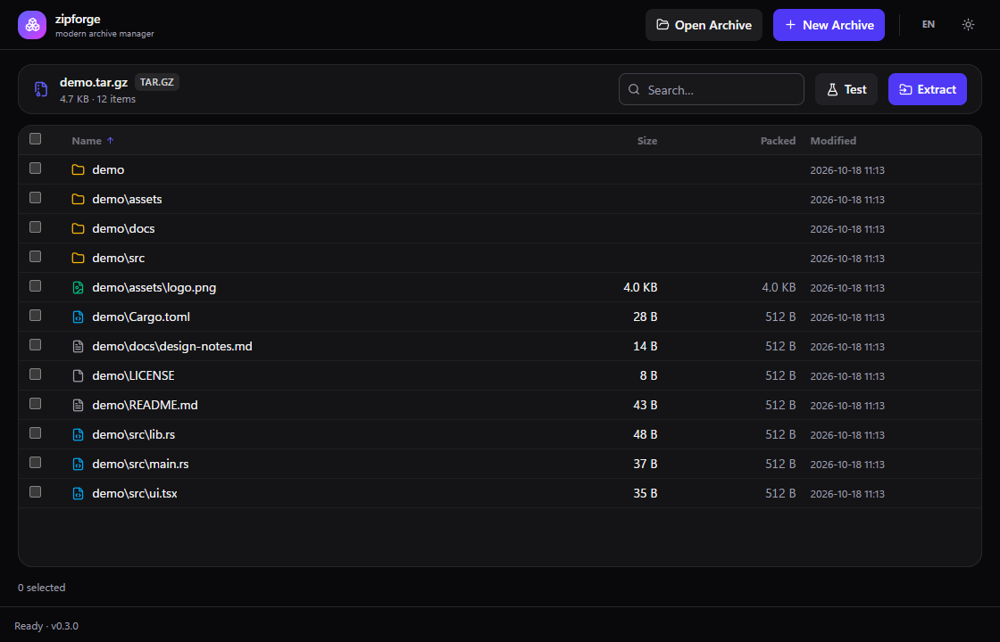

<div align="center">
  
</div>

<h1 align="center">zipforge</h1>

<p align="center">
  A fast, modern, open-source archive manager for Windows.<br/>
  Built with <b>Tauri v2</b> + <b>Rust</b> + <b>React</b> — small, native and quick.
</p>

<p align="center">
  
  
  
  
</p>

---

## Why zipforge?

- **Fast** — powered by the battle-tested 7-Zip engine (native C/C++), wrapped in a small Rust core.
- **Lightweight** — a Tauri app: uses the system WebView2 instead of bundling a browser (~10 MB installer vs ~150 MB for Electron apps).
- **Modern UI** — clean dark/light interface, drag & drop, keyboard-friendly, Turkish + English, no ads, no nag screens.
- **Honest formats** — opens everything you throw at it, creates the formats everyone actually uses.

## Features

- Open & browse archives without extracting, with instant search and sorting
- Extract all or only the selected entries, with real-time progress and cancel
- Create **zip / 7z / tar / tar.gz** archives with compression level selection
- **AES-256** password protection (zip & 7z), encrypted-header option for 7z
- **Split volumes** (e.g. 100 MB, 650 MB, 1 GB) for zip/7z
- Password-protected archives: prompts once, works across extract/test
- Archive integrity test
- Drag & drop files straight onto the window
- Dark / light theme (follows the system), TR / EN UI
- Overwrite / skip / rename policies on extraction
- **Explorer context menu** — create, open and extract archives straight from right-click (see below)

## Explorer integration

The installer registers per-user shell entries (no admin rights needed, removed cleanly on uninstall):

| Right-click on | Menu entry | Result |
|---|---|---|
| Folder, file or folder background | **Add to zipforge archive** | Opens the Create dialog with the selection pre-filled |
| An archive (zip, 7z, rar, tar.gz, iso, …) | **Open with zipforge** | Opens the archive in zipforge |
| An archive | **Extract here** | Extracts directly into the archive's folder |
| An archive | **Extract to folder** | Extracts into a new sub-folder named after the archive |

> Windows 11: the entries live in the classic menu — press **Shift+F10** or choose **Show more options**.
> Menu labels follow your Windows display language (Turkish / English).

## Supported formats

| | Read | Write |
|---|---|---|
| **zip** | ✅ (incl. AES) | ✅ (AES-256) |
| **7z** | ✅ (incl. header encryption) | ✅ |
| **rar / rar5** | ✅ | — (proprietary format) |
| **tar** | ✅ | ✅ |
| **tar.gz / tgz** | ✅ (lists & extracts inner files) | ✅ |
| **bz2 / xz / zst** | ✅ (incl. tar.bz2 / tar.xz / tar.zst) | — (roadmap) |
| **iso, cab, jar, apk, war, lzma, lz, …** | ✅ | — |

> Archive creation for `.rar` is not possible — RAR is a proprietary, licensed format. zipforge opens RAR archives, but creation is intentionally limited to open formats.

## Build from source

### Prerequisites (Windows)

- **Rust** (stable, MSVC toolchain) — <https://rustup.rs>
- **Visual Studio Build Tools** with the *Desktop development with C++* workload
- **Node.js 20+**
- **WebView2** (pre-installed on Windows 10/11)

### Steps

```powershell
git clone https://github.com/shayan1019/zipforge.git
cd zipforge

# 1. Copy the bundled 7-Zip engine (LGPL) into the app resources
powershell -ExecutionPolicy Bypass -File scripts/fetch-7z.ps1

# 2. Install frontend dependencies
npm install

# 3. Run in dev mode
npm run tauri dev

# 4. — or build a release binary + installer
npm run tauri build
```

The release installer is written to `src-tauri/target/release/bundle/`.

## Tech stack

- **[Tauri v2](https://tauri.app)** — tiny native shell, no bundled browser
- **Rust** — process management, streaming progress, cancellation
- **[7-Zip](https://www.7-zip.org)** console engine — the actual (un)packing
- **React 19 + TypeScript + Tailwind CSS v4** — the UI
- **lucide** icons

## Roadmap

- [x] Windows MVP: open zip/7z/rar/tar/gz/iso, create zip/7z/tar, passwords, split volumes, progress + cancel
- [x] tar.gz support — list & extract inner files, one-step tar.gz creation (v0.2.0)
- [x] Explorer context menu — pack, open, extract-here, extract-to-folder (v0.3.0)
- [ ] macOS support
- [ ] Auto-update
- [ ] Code-signed builds (SmartScreen reputation)
- [ ] tar.xz / tar.zst creation

## License

zipforge is released under the **MIT License** — see [LICENSE](LICENSE).

It bundles the 7-Zip console binaries (`7z.exe`, `7z.dll`), which are distributed under the
**GNU LGPL 2.1+** with the **unRAR restriction** (used here only for *reading* RAR archives).
The full license text ships next to the binaries in `src-tauri/resources/7z/License.txt`
and inside every release build.

---

<p align="center"><sub>No telemetry. No ads. No bundled toolbars. Just archives.</sub></p>
